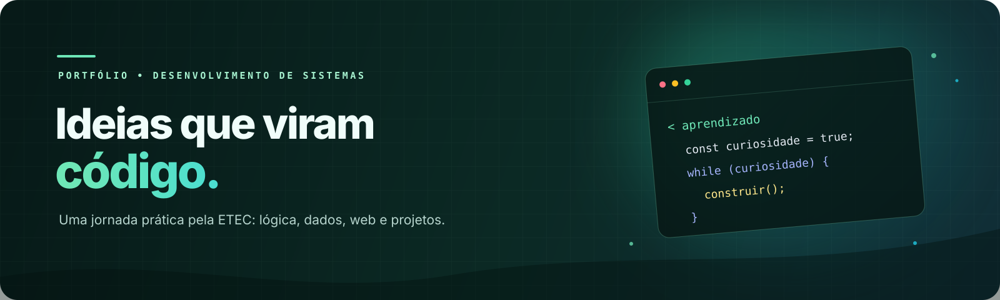

  
    
  
  
  
    
  <a href="#-mapa-do-repositório">Explorar as matérias</a> &nbsp;·&nbsp;
  <a href="#-projetos-e-práticas">Ver projetos</a> &nbsp;·&nbsp;
  <a href="#-como-navegar">Como navegar</a>

 

# Portfólio de estudos · ETEC

Um arquivo vivo da minha jornada no curso técnico em **Desenvolvimento de Sistemas** da **ETEC Profª Ilza Nascimento Pintus**. Aqui estão exercícios, experimentos, diagramas e projetos desenvolvidos ao longo das aulas — da primeira lógica até aplicações web e modelagem de dados.

> **Aprender fazendo.** Cada pasta é um pedaço do processo: ideias, tentativas, versões e soluções que marcaram a formação.

| 9 áreas de estudo | 448 arquivos de aula | prática em várias tecnologias |
|:---:|:---:|:---:|
| Conteúdo organizado por matéria | Exercícios, códigos e materiais | Python · SQL · PHP · Web · Portugol · C# |

## ✨ Mapa do repositório

Escolha uma matéria para abrir seus materiais. As pastas foram mantidas com seus nomes originais para preservar o histórico e facilitar a correspondência com as atividades.

| Área | O que você encontra | Acesso |
|:---|:---|:---:|
| **TPA** · Técnicas de Programação e Algoritmos | Fundamentos, estruturas de repetição, matrizes, vetores, Tkinter, JavaScript e Portugol. | [Explorar →](<./--%20TPA%20-->) |
| **BD I** · Banco de Dados I | Exercícios de SQL, DDL/DML, modelos entidade-relacionamento e estudos com bases de exemplo. | [Explorar →](<./--%20BD%20I%20-->) |
| **BD II** · Banco de Dados II | Projetos e estudos de caso: biblioteca, clínica, mercado, triggers e consultas. | [Explorar →](<./--%20BD%20II%20-->) |
| **PW I** · Programação Web I | Materiais e atividades introdutórias de desenvolvimento para a web. | [Explorar →](<./--%20PW%20I%20-->) |
| **PW II** · Programação Web II | Exercícios e projetos em PHP, formulários, CRUD e integração com banco de dados. | [Explorar →](<./--%20PW%20II%20-->) |
| **DS** · Desenvolvimento de Sistemas | Códigos, atividades e exercícios de lógica e desenvolvimento. | [Explorar →](<./--%20DS%20-->) |
| **DD** · Design Digital | Estudos visuais, logos e materiais de um projeto de site. | [Explorar →](<./--%20DD%20-->) |
| **APS** · Análise e Projeto de Sistemas | Questões, projeto ágil e diagramas UML. | [Explorar →](<./--%20APS%20-->) |
| **FI** · Fundamentos de Informática | Materiais de fundamentos e manutenção preventiva. | [Explorar →](<./--%20FI%20-->) |

## 🚀 Projetos e práticas

Alguns bons pontos de partida para passear pelo acervo:

- **Modelagem UML** — diagramas de atividade, casos de uso, classes e sequência em [APS → UML](<./--%20APS%20--/--%20UML%20-->).
- **Modelagem e SQL** — exercícios e projetos de bancos relacionais em [Banco de Dados I](<./--%20BD%20I%20-->) e [Banco de Dados II](<./--%20BD%20II%20-->).
- **Aplicações web** — exemplos de páginas, formulários e CRUD em [Programação Web II](<./--%20PW%20II%20-->).
- **Lógica e algoritmos** — práticas em Python, Portugol e JavaScript na pasta [TPA](<./--%20TPA%20-->).
- **Identidade visual e site** — experimentos de interface e recursos gráficos em [Design Digital](<./--%20DD%20-->).

## 🧭 Como navegar

1. Abra a matéria pela tabela acima.
2. Entre nas subpastas para encontrar listas, projetos, versões e arquivos de apoio.
3. Abra cada arquivo com a ferramenta adequada — por exemplo, `.py` com Python, `.sql` com um cliente de banco, `.html` no navegador e `.php` em um ambiente com servidor PHP.

**Observação:** este é um portfólio acadêmico, não um pacote único para execução. Alguns trabalhos podem depender de ferramentas, bancos de dados ou configurações específicas da época em que foram feitos. Há também arquivos compactados, rascunhos e versões repetidas: eles foram mantidos como parte do registro de aprendizagem.

## 🛠️ Tecnologias que aparecem por aqui

`Python` &nbsp; `SQL` &nbsp; `PHP` &nbsp; `HTML` &nbsp; `CSS` &nbsp; `JavaScript` &nbsp; `C#` &nbsp; `Portugol`

## 📄 Licença

O repositório está sob a licença [MIT](LICENSE). Os materiais de terceiros mantêm seus créditos e licenças originais quando aplicável.

---

  Feito com curiosidade, prática e muitas linhas de código.  
  Gabriel Henrique · ETEC Profª Ilza Nascimento Pintus

